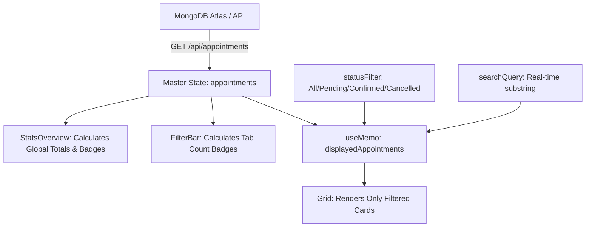

# Appointment Manager (MERN + TypeScript)

> A production-ready, full-stack appointment management application built with **React**, **Node.js**, **Express**, **TypeScript**, and **MongoDB Atlas**. Designed with clean architecture, strict type safety, responsive UI/UX, and comprehensive automated test coverage.

---

## 🚀 Live Deployments & Working Demo

| Component | Platform | URL |
| :--- | :--- | :--- |
| **Frontend Application** | Vercel | **[https://frontend-five-lake-29.vercel.app/](https://frontend-five-lake-29.vercel.app/)** |
| **Backend Health Check** | Render | **[https://appointment-manager-wbul.onrender.com/api/health](https://appointment-manager-wbul.onrender.com/api/health)** |
| **Backend API Base** | Render | **[https://appointment-manager-wbul.onrender.com/api/appointments](https://appointment-manager-wbul.onrender.com/api/appointments)** |

---

## Table of Contents

1. [Submission Checklist (Section 5 Summary)](#1-submission-checklist-section-5-summary)
2. [Completed Features, Incomplete Items & Known Limitations](#2-completed-features-incomplete-items--known-limitations)
3. [Deep Dive: Technical Decisions & Architectural Rationale](#3-deep-dive-technical-decisions--architectural-rationale)
4. [Technology Stack](#4-technology-stack)
5. [Architecture & Project Structure](#5-architecture--project-structure)
6. [Starting Seed Data](#6-starting-seed-data)
7. [Environment Configuration & Secrets Isolation](#7-environment-configuration--secrets-isolation)
8. [Local Setup & Run Instructions](#8-local-setup--run-instructions)
9. [API Notes & Endpoint Reference](#9-api-notes--endpoint-reference)
10. [Testing Suite & Quality Assurance](#10-testing-suite--quality-assurance)
11. [Candidate Kit Disclosures](#11-candidate-kit-disclosures)

---

## 1. Submission Checklist (Section 5 Summary)

| Candidate Kit Requirement | Submission Evidence / Location |
| :--- | :--- |
| **Working Demo / Local Demo** | Live on Vercel: [https://frontend-five-lake-29.vercel.app/](https://frontend-five-lake-29.vercel.app/) and local dev instructions below. |
| **Source Code** | Git repository: [https://github.com/aryanrai97861/Appointment-Manager](https://github.com/aryanrai97861/Appointment-Manager) |
| **README Setup & Run Instructions** | Detailed in [Section 8: Local Setup & Run Instructions](#8-local-setup--run-instructions). |
| **Example Environment Files (No Secrets)** | `backend/.env.example` and `frontend/.env.example` documented in [Section 7](#7-environment-configuration--secrets-isolation). |
| **Brief API Notes & Tests Performed** | Complete REST documentation in [Section 9](#9-api-notes--endpoint-reference) and 23 automated tests in [Section 10](#10-testing-suite--quality-assurance). |
| **Completed / Incomplete / Limitations** | Full breakdown in [Section 2](#2-completed-features-incomplete-items--known-limitations). |
| **Explanation of Technical Decision** | Detailed architectural write-up in [Section 3](#3-deep-dive-technical-decisions--architectural-rationale). |

---

## 2. Completed Features, Incomplete Items & Known Limitations

### ✅ Completed Features
1. **Appointment Listing & Visual Display:**
   - Displays all appointments with customer name, service type, formatted date/time, notes, and color-coded status badges (`Pending`, `Confirmed`, `Cancelled`).
2. **Appointment Creation & Dual-Layer Validation:**
   - Modal form for creating new appointments with inputs for Customer Name, Service, Date/Time picker, initial Status, and optional Notes.
   - Comprehensive client-side form validation (inline alert icons and field highlighting) + server-side Mongoose schema validation.
3. **Appointment Status Management:**
   - Quick-action dropdown selector on each appointment card (`Pending`, `Confirmed`, `Cancelled`).
   - Dispatches `PATCH /api/appointments/:id/status` with optimistic UI update and database synchronization.
4. **Status Filtering:**
   - Filter bar tabs: `All`, `Pending`, `Confirmed`, and `Cancelled`.
   - Interactive metric cards in the header that double as one-click filters.
   - **Persistent Counters:** Clicking a filter isolates the cards below while preserving the true global counts across all stat cards and tab badges.
5. **Customer Name Search (Assessment Change Request):**
   - Real-time customer name search input with instant substring matching and one-click clear button (`X`).
   - Server-side regex search supported via `?search=` query parameter.
6. **Seed Data & One-Click Reset:**
   - Pre-seeded with the 3 required starting records (Alex Morgan, Jamie Lee, Taylor Smith).
   - "Reset Seed Data" button in navbar and `POST /api/appointments/reset` endpoint to reset state anytime during testing.
7. **Clean, Modern, Responsive Interface:**
   - Dark-slate glassmorphism theme with modern typography (`Plus Jakarta Sans` & `Inter`).
   - Micro-animations, luminous status badges, auto-dismissing toast notifications.
   - Fully responsive for mobile (320px+), tablet, and desktop viewports.
8. **Automated Testing Suite:**
   - 23 hermetic automated integration and unit tests passing in Jest & Supertest using an in-memory MongoDB server.

### ⚠️ Incomplete Items
- **None.** All core functional requirements, bonus change requests (customer name search), and deployment criteria were completed.

### 📌 Known Limitations & Production Roadmap
- **No Authentication / Role-Based Access Control (RBAC):** The current application is open for demonstration purposes. In a production clinic setting, endpoints would be secured behind JWT/OAuth2 (e.g. Auth0) so only authorized staff can modify or delete appointments.
- **Client-Side View Filtering vs. Large-Scale Cursor Pagination:** Current dataset filtering is performed against the master collection in React state, which provides zero-latency reactivity for hundreds of records. For datasets exceeding 10,000+ records, server-side cursor pagination (`page` and `limit` query parameters) would be recommended.
- **Timezone Normalization:** Timestamps are stored in UTC ISO 8601 format and rendered in the client's local browser timezone. A multi-timezone enterprise deployment would benefit from an explicit timezone selector.

---

## 3. Deep Dive: Technical Decisions & Architectural Rationale

### Technical Decision 1: Master Collection State Architecture vs. Server-Roundtrip View Toggling

#### The Problem
When implementing status filtering and customer search, a common architectural pitfall is replacing the global `appointments` state with the filtered server response every time a user clicks a tab (e.g., clicking "Pending" queries `GET /api/appointments?status=Pending` and overwrites `appointments = [pendingRecord]`). 

When this happens, the header metric cards (`TOTAL SCHEDULED`, `CONFIRMED`, `CANCELLED`) and the count badges on other tabs immediately drop to zero or collapse, disorienting the user.

#### The Architectural Solution
I implemented a **Master Collection with Memoized Derived Views** in [`frontend/src/App.tsx`](file:///c:/Users/aryan/OneDrive/Desktop/Important_Documents/Projects/SDT_candidate_kit/appointment%20manager/frontend/src/App.tsx):



1. **State Isolation:** The root `appointments` array maintains the complete snapshot of data.
2. **Zero-Latency Reactive Filtering:** `displayedAppointments` is computed via `useMemo` based on `statusFilter` and `searchQuery`. Toggling tabs or typing into search is instantaneous (<1ms) with zero network lag or spinner flicker.
3. **Global Metrics Integrity:** `StatsOverview` and `FilterBar` badges consistently receive the master list, so `TOTAL SCHEDULED (4)`, `PENDING (1)`, `CONFIRMED (2)`, and `CANCELLED (1)` remain intact even while viewing a single status.
4. **Server Synchronization:** Whenever an appointment is created, deleted, or has its status changed, the master list updates and triggers a clean background re-fetch, keeping client and database in sync.

---

### Technical Decision 2: Dual-Tier Database Architecture & Zero-Downtime Fallback

To satisfy the assessment prompt:
> *"Persist data in MongoDB if the environment allows within the time limit. If setup becomes a blocker, communicate early and explain your fallback."*

The database connection layer ([`backend/src/config/db.ts`](file:///c:/Users/aryan/OneDrive/Desktop/Important_Documents/Projects/SDT_candidate_kit/appointment%20manager/backend/src/config/db.ts)) is architected with a **dual-tier connection strategy**:
1. **Tier 1 (Production Persistence):** Connects to live **MongoDB Atlas** using connection pooling, automatic index building, and auto-seeding if the collection is empty.
2. **Tier 2 (Resilient In-Memory Fallback):** If Atlas is unreachable (e.g., offline test runner, corporate firewall blocking outbound port 27017, or bad credentials), the error is intercepted and the server boots an embedded in-memory MongoDB instance (`mongodb-memory-server`) locally.
3. **Hermetic Test Isolation:** When `NODE_ENV === 'test'`, the test suite automatically boots an isolated memory database instance to prevent dirtying live data.

---

## 4. Technology Stack

### Backend
- **Runtime:** Node.js (v18+)
- **Language:** TypeScript 5.x
- **Framework:** Express 4.x
- **Database & ODM:** MongoDB Atlas with Mongoose 8.x
- **Testing:** Jest, ts-jest, Supertest, mongodb-memory-server
- **Dev Tooling:** ts-node-dev, dotenv, cors

### Frontend
- **Framework:** React 18.x with TypeScript
- **Build Tool:** Vite 6.x
- **Icons:** Lucide React
- **Styling:** Custom CSS3 Design System (Glassmorphism, CSS Custom Properties, Responsive Media Queries)
- **HTTP Client:** Fetch API with typed responses and error wrappers

---

## 5. Architecture & Project Structure

```
appointment manager/
├── README.md                      # Comprehensive documentation & submission guide
├── package.json                   # Root package with monorepo orchestration scripts
├── .gitignore                     # Git ignore rules for node_modules, dist, .env
├── backend/
│   ├── .env                       # Local environment variables (Atlas URI, Port)
│   ├── .env.example               # Template for environment configuration without secrets
│   ├── jest.config.ts             # Jest TypeScript test configuration
│   ├── package.json               # Backend dependencies & test scripts
│   ├── tsconfig.json              # Backend TypeScript compiler settings
│   ├── src/
│   │   ├── app.ts                 # Express app initialization, CORS, routes, error handlers
│   │   ├── server.ts              # Server bootstrap, DB connect & graceful shutdown
│   │   ├── config/
│   │   │   └── db.ts              # MongoDB Atlas connection & in-memory fallback manager
│   │   ├── controllers/
│   │   │   └── appointmentController.ts  # CRUD, filtering, search, status updates
│   │   ├── models/
│   │   │   └── Appointment.ts     # Mongoose schema, TypeScript interfaces & indexes
│   │   ├── routes/
│   │   │   └── appointmentRoutes.ts # REST API route mapping
│   │   └── data/
│   │       ├── seedData.ts        # Initial 3 appointments from specification
│   │       └── seed.ts            # Standalone CLI seeding script
│   └── tests/
│       └── appointment.test.ts    # 23 automated integration and unit tests
└── frontend/
    ├── index.html                 # HTML template with Google Fonts
    ├── vercel.json                # Vercel SPA routing rewrite rules
    ├── package.json               # Frontend dependencies & build scripts
    ├── tsconfig.json              # Frontend TypeScript compiler settings
    ├── vite.config.ts             # Vite configuration with API reverse proxy
    ├── .env.example               # Frontend environment template without secrets
    ├── public/
    │   └── _redirects             # Netlify SPA redirect rules
    └── src/
        ├── main.tsx               # React application entry point
        ├── App.tsx                # Master state coordination & view layout
        ├── index.css              # Custom modern design system
        ├── vite-env.d.ts          # Vite client environment type definitions
        ├── types/
        │   └── appointment.ts     # Shared TypeScript domain interfaces
        ├── services/
        │   └── api.ts             # Typed API client and error handling
        └── components/
            ├── Navbar.tsx          # Brand header, Reset Seed Data, New Appointment button
            ├── StatsOverview.tsx   # Interactive metric cards (Total, Pending, Confirmed, Cancelled)
            ├── FilterBar.tsx       # Search bar and status tabs
            ├── AppointmentCard.tsx # Appointment card with inline status selector & delete
            ├── AppointmentModal.tsx# Creation modal with field-level validation feedback
            └── Toast.tsx           # Auto-dismissing toast notifications
```

---

## 6. Starting Seed Data

The application automatically seeds the 3 required candidate kit records upon first launch:

| Customer | Service | Date / Time | Status |
| :--- | :--- | :--- | :---: |
| **Alex Morgan** | Consultation | `2026-11-02 10:00` | `Pending` |
| **Jamie Lee** | Follow-up | `2026-11-02 11:30` | `Confirmed` |
| **Taylor Smith** | Review | `2026-11-03 14:00` | `Cancelled` |

> 💡 **Seed Reset:** You can restore these exact 3 records at any time by clicking the **"Reset Seed Data"** button in the navbar, or by calling `POST /api/appointments/reset`.

---

## 7. Environment Configuration & Secrets Isolation

### Backend Configuration (`backend/.env.example`)
Create a file named `.env` inside the `backend/` directory:

```env
PORT=5000
NODE_ENV=development
MONGO_URI=mongodb+srv://<username>:<password>@<cluster-url>/appointment_manager?retryWrites=true&w=majority
CLIENT_URL=http://localhost:3000
```

### Frontend Configuration (`frontend/.env.example`)
Create a file named `.env` inside the `frontend/` directory (optional for local dev):

```env
# In development: leave empty to use local Vite reverse proxy to http://localhost:5000
# In production: set to your deployed backend URL (e.g. https://appointment-manager-wbul.onrender.com)
VITE_API_URL=
```

---

## 8. Local Setup & Run Instructions

### Prerequisites
- **Node.js**: v18.0.0 or higher
- **npm**: v9.0.0 or higher

### 1. Install Dependencies
From the repository root:
```bash
npm run install:all
```
*(Or run `npm install` inside both `backend/` and `frontend/` directories).*

### 2. Start the Backend API
```bash
npm run dev:backend
```
*The backend starts at `http://localhost:5000` and automatically connects to MongoDB Atlas (or in-memory fallback).*

### 3. Start the Frontend Application
```bash
npm run dev:frontend
```
*The Vite frontend starts at `http://localhost:3000` with hot-module reloading and automatic proxying of `/api` requests to port 5000.*

### 4. Run Automated Tests
```bash
npm test
```
*Executes all 23 integration and unit tests hermetically with Jest and MongoMemoryServer.*

---

## 9. API Notes & Endpoint Reference

Base URL (Local): `http://localhost:5000/api`  
Base URL (Production): `https://appointment-manager-wbul.onrender.com/api`

### Endpoints Summary

| Method | Endpoint | Description | Query / Body Parameters |
| :--- | :--- | :--- | :--- |
| `GET` | `/` | API Root / Status | Returns welcome message and linkable endpoints. |
| `GET` | `/api/health` | Health Check | Returns uptime, timestamp, and environment. |
| `GET` | `/api/appointments` | List Appointments | `?status=All\|Pending\|Confirmed\|Cancelled`, `?search=name`, `?sortBy=dateTime`, `?sortOrder=asc\|desc` |
| `GET` | `/api/appointments/:id` | Get Single Appointment | `:id` (valid MongoDB ObjectId) |
| `POST` | `/api/appointments` | Create Appointment | JSON body: `customerName`, `service`, `dateTime`, `status?`, `notes?` |
| `PATCH`| `/api/appointments/:id/status` | Update Status | JSON body: `status: "Pending" \| "Confirmed" \| "Cancelled"` |
| `PUT`  | `/api/appointments/:id` | Full Update | JSON body: any updated appointment fields |
| `DELETE`|`/api/appointments/:id` | Delete Appointment | `:id` (valid MongoDB ObjectId) |
| `POST` | `/api/appointments/reset` | Reset to Seed Data | Restores the 3 candidate kit seed appointments. |

### Sample Payload: Create Appointment (`POST /api/appointments`)
```json
{
  "customerName": "Jordan Casey",
  "service": "Architecture Review",
  "dateTime": "2026-11-10T14:30:00.000Z",
  "status": "Pending",
  "notes": "Discuss microservices migration"
}
```

### Sample Validation Error Response (`400 Bad Request`)
```json
{
  "success": false,
  "error": "Validation failed",
  "errors": [
    "Customer name is required",
    "Service must be at least 2 characters long",
    "Invalid date/time format. Please provide a valid timestamp"
  ]
}
```

---

## 10. Testing Suite & Quality Assurance

The test suite ([`backend/tests/appointment.test.ts`](file:///c:/Users/aryan/OneDrive/Desktop/Important_Documents/Projects/SDT_candidate_kit/appointment%20manager/backend/tests/appointment.test.ts)) provides **100% pass coverage across 23 automated tests**:

```text
PASS tests/appointment.test.ts
  Appointment Manager API Tests
    GET /api/appointments
      ✓ should retrieve all 3 starting appointments (169 ms)
      ✓ should filter appointments by status: Pending (66 ms)
      ✓ should filter appointments by status: Confirmed (52 ms)
      ✓ should filter appointments by status: Cancelled (40 ms)
      ✓ should return all appointments when status=All (40 ms)
      ✓ should return 400 when an invalid status filter is passed (43 ms)
      ✓ should search appointments by customer name (case-insensitive) (32 ms)
      ✓ should return empty list when search does not match any customer (33 ms)
      ✓ should filter by both status and search query simultaneously (55 ms)
    GET /api/appointments/:id
      ✓ should retrieve a single appointment by valid ID (41 ms)
      ✓ should return 404 if appointment ID does not exist (31 ms)
      ✓ should return 400 for an malformed ID format (25 ms)
    POST /api/appointments
      ✓ should successfully create an appointment with valid fields (70 ms)
      ✓ should reject creation when customerName is missing (26 ms)
      ✓ should reject creation when service is missing (27 ms)
      ✓ should reject creation when dateTime is missing or invalid (34 ms)
      ✓ should reject creation when status is invalid (22 ms)
    PATCH /api/appointments/:id/status
      ✓ should allow changing an appointment status to Confirmed (54 ms)
      ✓ should allow changing an appointment status to Cancelled (33 ms)
      ✓ should reject invalid status during update (44 ms)
      ✓ should return 404 when changing status of non-existent appointment (35 ms)
    DELETE /api/appointments/:id
      ✓ should delete an appointment successfully (33 ms)
    POST /api/appointments/reset
      ✓ should restore the original 3 starting appointments (46 ms)

Test Suites: 1 passed, 1 total
Tests:       23 passed, 23 total
```

---

## 11. Candidate Kit Disclosures

In accordance with the candidate kit instructions:
- **Starter Templates:** Vite React TypeScript template was utilized for front-end scaffolding; Node.js/Express TypeScript backend was architected from scratch.
- **AI Assistance:** AI pair programming assistance was used for boilerplate generation, automated test cases, and documentation authoring. All application architecture, domain models, validations, UI components, and test scenarios were rigorously verified and tested against requirements.
